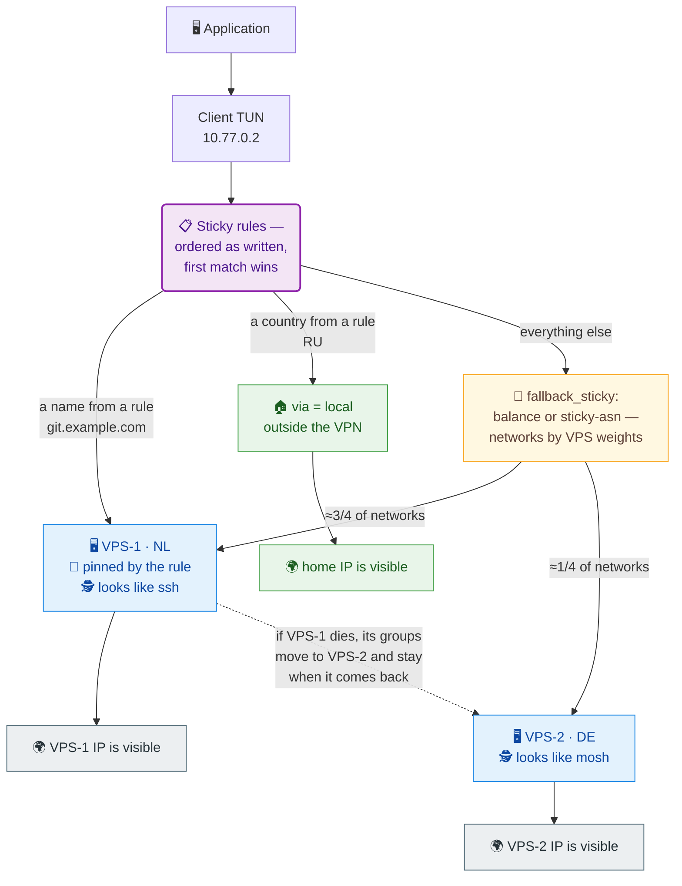

# SVPN

SVPN is a VPN client and VPN server in one executable. The client starts the
server on a VPS over SSH for the session: no daemon, systemd service or
separate configuration on the VPS.

## How it works



The diagram's three branches are literally the config: `sticky` rules are
checked top to bottom, the first match deciding where the address goes.
Replace the domains, countries and addresses with your own:

```hcl
sticky "work" {
  names = ["git.example.com", "ci.example.com"]
  via   = ["nl"]        # pinned to one VPS
  every = "5m"          # names re-resolve on their own
}

sticky "ru" {
  countries = ["RU"]
  via       = local     # outside the VPN: the site sees your home IP
}

// the diagram's third branch — whatever the rules did not catch:
fallback_sticky {
  strategy = "sticky-asn"   // or "balance": networks by VPS weights,
}                           // sticky-asn keeps each on one server
```

When a VPS dies its groups move to the next one in `via` and stay there
when it returns — the external IP never flips back. `sticky-asn` pins every
destination network to one VPS so a service sees a stable IP. Tunnel
traffic is disguised: the client itself picks what to look like on the
channel and switches to TCP when UDP is blocked.

## Quick start

You need a Linux client and one Linux VPS with root SSH. The client needs TUN,
`iproute2` and `nftables`. On the VPS allow SSH, TCP `41020` and UDP
`60000–60009`.

### 1. Install SVPN on the client

```bash
VERSION=1.1.1
curl -fLO "https://github.com/vadv/svpn/releases/download/v${VERSION}/svpn-${VERSION}-linux-x86_64-gnu.tar.gz"
tar -xzf "svpn-${VERSION}-linux-x86_64-gnu.tar.gz"
sudo install -m 755 svpn /usr/local/bin/svpn
svpn --version
```

For aarch64 use the `linux-aarch64-gnu` archive.

### 2. Check SSH to the VPS

```bash
ssh -i /full/path/to/key root@203.0.113.10
```

If the key is passphrase-protected, load it into `ssh-agent` first. Instead of
root you can use a regular user with passwordless `sudo -n`.

### 3. Prepare the VPS

```bash
sudo svpn setup --server 203.0.113.10 --ssh-user root --ssh-identity /full/path/to/key
```

The command downloads the SVPN release on the VPS itself, installs the binary
and verifies the installation. Debian/Ubuntu (apt) and Rocky/CentOS Stream
(dnf) on x86_64 and aarch64 are supported.

In auto mode the embedded `scripts/client-up`, `scripts/client-down`,
`scripts/server-up` and `scripts/server-down` from the current binary run.
You can inspect their exact text before starting:

```bash
svpn example client-up
svpn example client-down
svpn example server-up
svpn example server-down
```

To override, save the output, edit the file and point to it in the config —
see [ADVANCED.en.md](ADVANCED.en.md).

### 4. Start

```bash
sudo -E svpn --server 203.0.113.10 --ssh-user root --ssh-identity /full/path/to/key
```

Stop with `Ctrl-C`. For systemd autostart see [ADVANCED.en.md](ADVANCED.en.md).

### 5. Verify

```bash
curl -4 https://ifconfig.me   # should print your VPS IP
ping -c1 1.1.1.1
```

If `ifconfig.me` shows the VPS IP, traffic goes through the tunnel.

### Several VPSs — no harder than one

One `server` block per server, shared SSH settings on top. The config is HCL:

```hcl
# vpn.hcl
ssh {
  user     = "root"
  identity = "/full/path/to/key"
}

server "nl" {
  address = "203.0.113.10"
}

server "de" {
  address = "198.51.100.20"
}
```

```bash
sudo svpn setup --config vpn.hcl      # provision both VPSs
sudo -E svpn multi --config vpn.hcl   # run
```

`sticky` rules referencing these labels (`"nl"`, `"de"`) go into the same
config — the example from the diagram above is ready to paste. Traffic
matched by no block is distributed across the servers by weights (equal by
default); a failing VPS moves over to the rest. Details in
[ADVANCED.en.md](ADVANCED.en.md).

## Country and ASN databases — only for sticky modes

You do not need databases for a plain VPN. They are needed to pin exits by
country or ASN (sticky blocks in ADVANCED). SVPN downloads and updates them
by itself — enable `auto_job_update` in the database blocks and restart:

```hcl
geo     { db = "/etc/svpn/asn.csv";     auto_job_update = true }
country { db = "/etc/svpn/country.csv"; auto_job_update = true }
```

Startup does not wait for the database: when it is missing, the VPN starts
degraded (the `balance` fallback), the job fetches the file in the
background and the sticky modes activate live, without a restart. Manual
check: `svpn job run geo-update --config vpn.hcl` (the exit code is the
job's). For your own mirror or schedule, `svpn example job-geo-update`
prints the same job block as a starting point (paste it AND turn
`auto_job_update` off, or the labels collide).

Once by hand (when jobs are not wanted):

```bash
sudo install -d -m 700 /etc/svpn
YEAR_MONTH=$(date -u +%Y-%m)

curl -fL "https://download.db-ip.com/free/dbip-country-lite-${YEAR_MONTH}.csv.gz" -o /tmp/country.csv.gz
gzip -dc /tmp/country.csv.gz | sudo tee /etc/svpn/country.csv >/dev/null

curl -fL "https://download.db-ip.com/free/dbip-asn-lite-${YEAR_MONTH}.csv.gz" -o /tmp/asn.csv.gz
gzip -dc /tmp/asn.csv.gz | sudo tee /etc/svpn/asn.csv >/dev/null
sudo chmod 600 /etc/svpn/country.csv /etc/svpn/asn.csv
```

Country DB answers “which country is this address”, ASN DB answers “which
network is it”. Enabling the modes is covered in ADVANCED.

## Next steps

Everything beyond the quick-start pair of servers is covered in
[ADVANCED.en.md](ADVANCED.en.md):

- `sticky` blocks: pinning exits by DNS names, IPs, ASNs and countries;
- `via = local` — sending selected addresses outside the VPN;
- `fallback_sticky` — how the pool serves the remaining traffic;
- Country and ASN databases and their background auto-update
  (`auto_job_update`);
- hooks and environment variables;
- transport: mimic, TCP fallback, UDP port range;
- systemd and readiness checks;
- `svpn setup` details: environments, fallback, downgrade, statuses.

## Build

```bash
cargo build --release --target x86_64-unknown-linux-gnu
cargo test --workspace
```

Checks before a pull request:

```bash
cargo fmt --all -- --check
cargo clippy --workspace --all-targets -- -D warnings
uvx ruff@0.14.3 check
uvx ruff@0.14.3 format --check
python3 e2e/test_artifacts.py
python3 e2e/test_groups.py
python3 e2e/test_package.py
```

## More information

- [ADVANCED.en.md](ADVANCED.en.md) — advanced configuration.
- [CHANGELOG](CHANGELOG.md) — version history.
- [Russian README](README.md).
- `svpn --help` — command reference.
