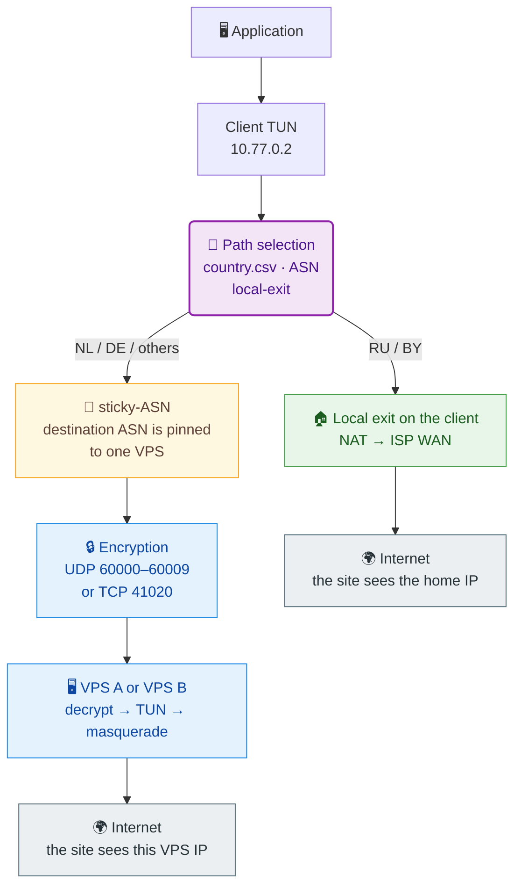

# SVPN

SVPN is a client and server in one executable. It creates a secure IPv4
tunnel over SSH.

This guide starts with one complete setup that enables all three features:

- destinations in **Russia and Belarus** use `local-exit`;
- destinations in **the Netherlands and Germany** use two VPN exits;
- all other IPv4 destinations use both VPN exits with ASN affinity and weights.

Belarus uses the ISO code `BY`, Russia uses `RU`.

> **Platform: Linux.** This complete recipe uses a Linux client and two Linux
> servers. Do not copy its hooks to macOS. A macOS local-exit setup needs
> separate routing, forwarding and NAT commands.

## Quick start

```bash
# /etc/svpn/vpn.toml already exists — see section 5
sudo svpn setup --config /etc/svpn/vpn.toml   # once: VPS, binary and hooks
sudo svpn multi --config /etc/svpn/vpn.toml   # start the tunnel
```

## 1. Prepare the machines

| Machine | Requirements |
|---|---|
| Linux client | Root for this recipe, TUN, `iproute2`, `nftables`, `curl`, `gzip` and a default route through the physical interface and gateway |
| Each of the two VPSs | Linux, TUN, `iproute2`, `nftables`, root SSH and working Internet egress |
| Network | Permit SSH, TCP `41020` and UDP `60000–60009` to each VPS |

The VPS firewall must permit forwarding between TUN and the physical egress
interface. The NAT example does not change the existing firewall policy. Do
not disable the firewall.

Use the same SVPN version everywhere. Download the build for each machine's OS
and CPU architecture. Client and server are roles of one program, not a reason
to copy one platform-specific binary to every machine.

## 2. Install SVPN

Open [releases](https://github.com/vadv/svpn/releases) and download one
matching archive per machine:

- `svpn-<version>-linux-x86_64-gnu.tar.gz` for GNU Linux x86_64;
- `svpn-<version>-linux-aarch64-gnu.tar.gz` for GNU Linux aarch64;
- `svpn-<version>-macos-arm64.tar.gz` for macOS Apple Silicon;
- `svpn-<version>-openwrt-aarch64.tar.gz` for OpenWrt aarch64.

For Linux x86_64, run this on the client and each VPS. Replace the release
version first:

```bash
VERSION=0.9.6
curl -fLO "https://github.com/vadv/svpn/releases/download/v${VERSION}/svpn-${VERSION}-linux-x86_64-gnu.tar.gz"
tar -xzf "svpn-${VERSION}-linux-x86_64-gnu.tar.gz"
sudo install -m 755 svpn /usr/local/bin/svpn
svpn --version
```

Extract one selected archive at a time. Install the `svpn` file from that
archive rather than mixing files from different builds.

Besides the binary, every archive carries `scripts/server-up` and
`scripts/server-down` — the same hooks `svpn setup` deploys. For a manual
install without `svpn setup` (for example on OpenWrt) take them from the
archive.

## 3. Download country and ASN databases

Both databases belong on the **client**, not on the VPSs. The directory and
files are root-only:

```bash
sudo install -d -m 700 /etc/svpn
YEAR_MONTH=$(date +%Y-%m)

curl -fL "https://download.db-ip.com/free/dbip-country-lite-${YEAR_MONTH}.csv.gz" -o /tmp/country.csv.gz
gzip -dc /tmp/country.csv.gz | sudo tee /etc/svpn/country.csv >/dev/null

curl -fL "https://download.db-ip.com/free/dbip-asn-lite-${YEAR_MONTH}.csv.gz" -o /tmp/asn.csv.gz
gzip -dc /tmp/asn.csv.gz | sudo tee /etc/svpn/asn.csv >/dev/null
sudo chmod 600 /etc/svpn/country.csv /etc/svpn/asn.csv
```

Country Lite maps destination addresses to countries. ASN Lite enables
`sticky-asn`. You can use `scripts/update-asn-db.sh` from the source tree for
later ASN updates. A source checkout is not needed for the initial download.

## 4. Check SSH

Keep the private key on the client. Authorize its public key for `root` on
both VPSs. Test both logins before starting SVPN:

```bash
ssh -i /absolute/path/to/key root@nl.example.com
ssh -i /absolute/path/to/key root@de.example.com
```

Use an absolute key path. Load passphrase-protected keys into `ssh-agent`
before starting. When using `sudo -E`, agent preservation depends on the sudo
policy.

Without `ssh-host-key`, SVPN uses TOFU and stores the fingerprint in its own
known-hosts file. For strict verification, obtain the fingerprint from your
provider and add `ssh-host-key = "SHA256:..."` to each server. Do not add an
empty value.

## 5. Create one configuration

Run `sudoedit /etc/svpn/vpn.toml`. Replace `nl.example.com` and `de.example.com` with the
servers' IPv4 addresses in `servers` **and in the hooks**. Replace the key
path.

```toml
exit-policy = "sticky-asn"
country-db = "/etc/svpn/country.csv"
geo-db = "/etc/svpn/asn.csv"
exit-state = "/etc/svpn/exits.json"
local-exits = ["RU", "BY"]

ssh-user = "root"
ssh-identity = "/absolute/path/to/key"
ssh-port = 22
ssh-remote-bin = "/usr/local/bin/svpn"
mimic = ["ssh"]
tcp-port = 41020
udp-port-range = "60000-60009"

# Protect the VPS addresses before replacing the default route. This assumes
# no pre-existing host routes for these addresses.
up-command = "wan=$(ip -4 route show default | awk 'NR==1{print $5}'); gateway=$(ip -4 route show default | awk 'NR==1{print $3}'); for ip in nl.example.com de.example.com; do ip route replace \"$ip/32\" via \"$gateway\" dev \"$wan\"; done; ip route replace 0.0.0.0/1 dev \"$SVPN_TUN_NAME\"; ip route replace 128.0.0.0/1 dev \"$SVPN_TUN_NAME\""
down-command = "for ip in nl.example.com de.example.com; do ip route del \"$ip/32\" 2>/dev/null || true; done"

# These server hooks run on each VPS and at the local-exit on the client.
server-up = '''
sysctl -qw net.ipv4.ip_forward=1
n=$(printf '%s\n' "$SVPN_PEER_ADDR" | cut -d. -f3)
table_id=$((10000 + n))
table=svpn_egress_$n
owner=/run/svpn-egress-$SVPN_SESSION_ID-$table_id
rm -f "$owner.rule" "$owner.route" "$owner.nat"
wan=$(ip -4 route show default | awk 'NR==1{for(i=1;i<=NF;i++) if($i=="dev"){print $(i+1); exit}}')
gateway=$(ip -4 route show default | awk 'NR==1{print $3}')
if ip -4 rule show pref "$table_id" | grep -v "from $SVPN_PEER_ADDR lookup $table_id" | grep -q .; then
    echo "svpn: policy priority $table_id is already in use" >&2
    exit 1
fi
if ip -4 route show table "$table_id" | grep -v "via $gateway dev $wan" | grep -q .; then
    echo "svpn: policy table $table_id is already in use" >&2
    exit 1
fi
if ! ip -4 rule show pref "$table_id" | grep -q "from $SVPN_PEER_ADDR lookup $table_id"; then
    ip rule add pref "$table_id" from "$SVPN_PEER_ADDR" table "$table_id"
fi
: > "$owner.rule"
ip route replace default via "$gateway" dev "$wan" table "$table_id"
: > "$owner.route"
nft delete table inet "$table" 2>/dev/null || true
nft -f - <<EOF
add table inet $table
add chain inet $table postrouting { type nat hook postrouting priority srcnat; }
add rule inet $table postrouting ip saddr $SVPN_PEER_ADDR masquerade
EOF
: > "$owner.nat"
'''
server-down = '''
n=$(printf '%s\n' "$SVPN_PEER_ADDR" | cut -d. -f3)
table_id=$((10000 + n))
owner=/run/svpn-egress-$SVPN_SESSION_ID-$table_id
wan=$(ip -4 route show default | awk 'NR==1{for(i=1;i<=NF;i++) if($i=="dev"){print $(i+1); exit}}')
gateway=$(ip -4 route show default | awk 'NR==1{print $3}')
if [ -f "$owner.rule" ]; then
    ip rule del pref "$table_id" from "$SVPN_PEER_ADDR" table "$table_id" 2>/dev/null || true
    rm -f "$owner.rule"
fi
if [ -f "$owner.route" ]; then
    ip route del default via "$gateway" dev "$wan" table "$table_id" 2>/dev/null || true
    rm -f "$owner.route"
fi
if [ -f "$owner.nat" ]; then
    nft delete table inet "svpn_egress_$n" 2>/dev/null || true
    rm -f "$owner.nat"
fi
'''

[[servers]]
address = "nl.example.com"
weight = 3
countries = ["NL", "DE"]

[[servers]]
address = "de.example.com"
weight = 1
countries = ["NL", "DE"]
```

Weights `3` and `1` mean an approximate 3:1 distribution. With `sticky-asn`,
addresses in one network keep their selected exit while it remains healthy.
Weights affect owner selection, not every individual packet.

### How the path is selected

| Destination | Path |
|---|---|
| `RU` or `BY` | `local-exit` through the local SVPN server and physical egress |
| `NL` or `DE` | Only servers listing that country in `countries` |
| Any other country or an address outside Country DB | Both example servers, using ASN affinity and weights |



The paths differ not only in route but in the visible address. `local-exit` leaves
through the client's ISP, so the site sees the home IP. The VPN branch pins every
destination ASN to one VPS while it is alive: a service sees that server's stable
IP. If the VPS fails, the ASN group moves to the next server in the pool.

One country can have several servers. `countries` restricts selection for that
country but does not remove the server from the general pool for other
countries. A server without `countries` also participates in ordinary
selection.

`local-exit` is not a TCP proxy. SVPN forwards IPv4 packets through its local
server. It needs `server-up` and `server-down`. Return routes are managed by
SVPN automatically. The hook sends packets sourced from `SVPN_PEER_ADDR`
through the physical uplink instead of back into the primary TUN.

The example `server-up` enables IPv4 forwarding and uses policy table
`10000+n`. It rejects foreign rules and tables. It does not restore the
previous forwarding value on shutdown. It assumes no pre-existing host routes to
`nl.example.com` or `de.example.com`. If you already have such routes, save them and add
restoration to your own `down-command`.

## 6. Start and verify

Start in the foreground:

```bash
sudo -E svpn multi --config /etc/svpn/vpn.toml
```

Wait for both remote exits and `local-exit: ready`. Verify four things:

1. **Connectivity.** Check a responding IPv4 address with `ping` or `curl`.
2. **local-exit.** Choose a responding address from a `RU` or `BY` range in
   `/etc/svpn/country.csv`. The `local: opened` counter should increase.
3. **VPN.** An `NL` or `DE` address should open a flow on one VPS. An address
   in another country should also use one of the two VPSs.
4. **Stable ownership.** Repeated flows to addresses in one network should use
   the same server. When the owner fails, new flows move to a reserve server.
   Recovery of the old server does not cause snap-back.

A single `ping 1.1.1.1` does not verify Geo routing or sticky ASN. Use
addresses present in the installed Country DB and responding to the selected
protocol.

After verification, stop the foreground command with `Ctrl-C` and enable the
service:

```bash
sudo install -d -m 700 /etc/systemd/system
sudo tee /etc/systemd/system/svpn.service >/dev/null <<'EOF'
[Unit]
Description=SVPN
After=network-online.target
Wants=network-online.target

[Service]
ExecStart=/usr/local/bin/svpn multi --config /etc/svpn/vpn.toml
Restart=on-failure
RestartSec=2

[Install]
WantedBy=multi-user.target
EOF
sudo systemctl daemon-reload
sudo systemctl enable --now svpn
systemctl status svpn
journalctl -u svpn -f
```

## 7. Use only one feature

Only a single VPN between client and server:

```bash
sudo svpn root@nl.example.com
```

Sticky ASN without local-exit:

```toml
exit-policy = "sticky-asn"
geo-db = "/etc/svpn/asn.csv"
```

Country selection without local-exit:

```toml
country-db = "/etc/svpn/country.csv"

[[servers]]
address = "nl.example.com"
countries = ["NL"]

[[servers]]
address = "de.example.com"
countries = ["DE"]
```

`local-exits` and `countries` require `country-db`. `sticky-asn` requires
`multi` and `geo-db`. Do not add settings that your scenario does not use.

## 8. Update databases

SVPN loads CSV files at startup and does not reload them live. Replace the
files and restart the service:

```bash
sudo systemctl restart svpn
```

For ASN, `scripts/update-asn-db.sh` downloads and validates a new database and
keeps the previous file as `asn.csv.prev`. The script is in the source tree,
not in the binary archive.

## 9. Reference notes

### Transport

The default is SSH camouflage with UDP. If UDP is blocked, set
`mimic = ["ssh"]` and `tcp-port = 41020`. Set the UDP range with
`udp-port-range = "60000-60009"`.

### Hooks

`up-command` and `down-command` run on the client. `server-up` and
`server-down` run on VPSs and at the local-exit. Client commands can use
`up-script` and `down-script`. Hooks receive `SVPN_EVENT`, `SVPN_TUN_NAME`,
`SVPN_TUN_ADDR`, `SVPN_PEER_ADDR` and `SVPN_SESSION_ID`. The timeout is 10
seconds.

### Readiness

In foreground, look for `serving` and `local-exit: ready`. With systemd, use
`journalctl -u svpn -f`. Repeated runs of the same configuration use address
pairs from `10.77.0.0/16`. If a pair conflicts, inspect addresses with
`ip addr`.

### ASN owners

`exit-state` stores selected owners. By default, the state path is derived
from `geo-db` with a `.state.json` suffix. It survives restarts. Snap-back is
not performed.

### Limits

- Only IPv4 is tunnelled. This configuration does not protect IPv6.
- DNS is not changed automatically. Choose DNS separately.
- Country and ASN databases classify IP addresses, not domains. Selection
  happens after name resolution.
- The complete Linux recipe uses TUN, root, `iproute2` and `nftables`.
- Client hooks do not run after `SIGKILL`. The kernel closes TUN and sockets.
  The next start must restore its routes and rules. Do not use hooks for
  irreversible changes to resources you do not own.

## 10. Provision the VPSs with one command: `svpn setup`

```bash
sudo svpn setup --config /etc/svpn/vpn.toml
```

The command prepares every VPS from the existing configuration: it
detects the environment, installs the missing approved packages (`curl`,
`tar`, `gzip`, `awk`, `ip`, `nft`, `sysctl`, CA certificates), downloads
the SVPN release from GitHub on the VPS itself and installs the
`server-up`/`server-down` hooks embedded in the client binary. The
configuration file is never modified.

Supported environments: Debian 12 and Rocky 10 (GNU libc) on x86_64 and
aarch64 with hardware AES. SSH access as `root` or as a regular user with
passwordless `sudo -n`; passwords and interactive sudo are not supported.
OpenWrt, Alpine and musl are not covered.

Repeat runs and versions:

- Only the managed files are overwritten: `/usr/local/bin/svpn`,
  `/usr/local/lib/svpn/server-up`, `/usr/local/lib/svpn/server-down`.
  Each replacement is atomic; the set as a whole is not, and the report
  shows `partial` honestly.
- The client's exact version is preferred. If its release or platform
  archive is unavailable, the latest stable release with compatible
  control/hook metadata is selected and the reason is reported. A
  checksum failure is an error, never a switch to another release.
- A selected older version may replace a newer installation; setup
  reports this explicitly in a `downgrade=` field.

After installation the hashes, modes and the binary version are verified.
Setup never starts SVPN and never executes the hooks: it activates no
routes, NAT, DNS or firewall, creates no services and does not touch
local-exit. The hook paths must already be present in the client
configuration — setup does not add them.

Hosts are processed in configuration order; one failing host does not
stop the others. Every host prints a
`SETUP host=… status=success|failed|partial|unknown|not-attempted` line
with the selected version, a `downgrade=` field and the `changed=` list.
The aggregate exit code is nonzero after any failure. Interruption
(Ctrl+C, SIGTERM) stops new hosts: the active host is reported `unknown`,
the remaining ones `not-attempted`.

## More information

- `svpn --help` — command reference.
- [CHANGELOG](CHANGELOG.md) — version history.
- [Protocol](docs/PROTOCOL.md) — transport details.
- [Russian README](README.md).

## Build

```bash
cargo build --release --target x86_64-unknown-linux-gnu
cargo test --workspace
```

Before a pull request:

```bash
cargo fmt --all -- --check
cargo clippy --workspace --all-targets -- -D warnings
uvx ruff@0.14.3 check
uvx ruff@0.14.3 format --check
python3 e2e/test_artifacts.py
python3 e2e/test_groups.py
python3 e2e/test_package.py
```
