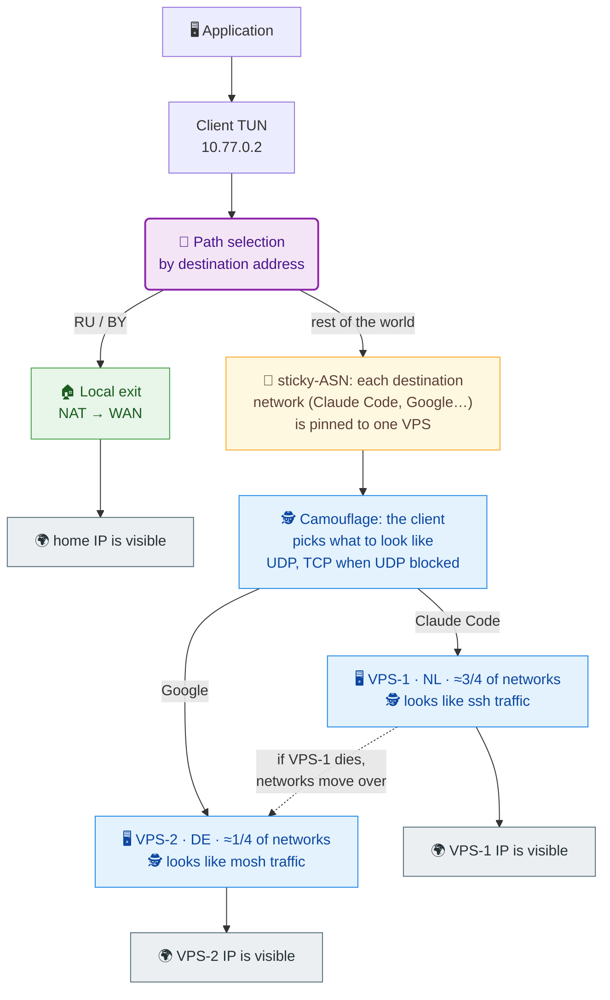

# SVPN

SVPN is a VPN client and VPN server in one executable. The client starts the
server on a VPS over SSH for the session: no daemon, systemd service or
separate configuration on the VPS.

## How it works



The client picks the path before encryption. Addresses in `local-exits` (for
example RU and BY) leave through the local exit — the site sees your home IP.
Everything else is encrypted and sent to a VPS — the site sees the server IP.
With several VPSs, `sticky-asn` pins every destination ASN to one server so a
service sees a stable external IP. Tunnel traffic is disguised: the client
itself picks what to look like on the channel and switches to TCP when UDP is
blocked.

## Quick start

You need a Linux client and one Linux VPS with root SSH. The client needs TUN,
`iproute2` and `nftables`. On the VPS allow SSH, TCP `41020` and UDP
`60000–60009`.

### 1. Install SVPN on the client

```bash
VERSION=0.9.6
curl -fLO "https://github.com/vadv/svpn/releases/download/v${VERSION}/svpn-${VERSION}-linux-x86_64-gnu.tar.gz"
tar -xzf "svpn-${VERSION}-linux-x86_64-gnu.tar.gz"
sudo install -m 755 svpn /usr/local/bin/svpn
svpn --version
```

For aarch64 use the `linux-aarch64-gnu` archive. Besides the binary, the
archive carries `scripts/server-up` and `scripts/server-down` — the server
hooks.

### 2. Check SSH to the VPS

```bash
ssh -i /full/path/to/key root@203.0.113.10
```

If the key is passphrase-protected, load it into `ssh-agent` first. Instead of
root you can use a regular user with passwordless `sudo -n`.

### 3. Prepare the VPS

```bash
sudo svpn setup --server 203.0.113.10 --ssh-user root --ssh-identity /full/path/to/key
```

The command downloads the SVPN release on the VPS itself, installs the binary
and verifies the installation. Debian 12 and Rocky 10 on x86_64 and aarch64
are supported.

Setup also leaves example `server-up` and `server-down` in
`/usr/local/lib/svpn/`. They do not run by default: `serve` uses the hooks
embedded in the current build. To override, edit the example and point to it
in the config — see [ADVANCED.en.md](ADVANCED.en.md).

### 4. Start

```bash
sudo -E svpn --server 203.0.113.10 --ssh-user root --ssh-identity /full/path/to/key
```

Stop with `Ctrl-C`. For systemd autostart see [ADVANCED.en.md](ADVANCED.en.md).

### 5. Verify

```bash
curl -4 https://ifconfig.me   # should print your VPS IP
ping -c1 1.1.1.1
```

If `ifconfig.me` shows the VPS IP, traffic goes through the tunnel.

## Country and ASN databases — only for local-exit and sticky-asn

You do not need databases for a plain VPN. To send RU/BY destinations directly
or pin the exit by ASN, download them on the client:

```bash
sudo install -d -m 700 /etc/svpn
YEAR_MONTH=$(date +%Y-%m)

curl -fL "https://download.db-ip.com/free/dbip-country-lite-${YEAR_MONTH}.csv.gz" -o /tmp/country.csv.gz
gzip -dc /tmp/country.csv.gz | sudo tee /etc/svpn/country.csv >/dev/null

curl -fL "https://download.db-ip.com/free/dbip-asn-lite-${YEAR_MONTH}.csv.gz" -o /tmp/asn.csv.gz
gzip -dc /tmp/asn.csv.gz | sudo tee /etc/svpn/asn.csv >/dev/null
sudo chmod 600 /etc/svpn/country.csv /etc/svpn/asn.csv
```

Country DB answers “which country is this address”, ASN DB answers “which
network is it”. Enabling these modes and the multi-server TOML is covered in
ADVANCED.

## Next steps

Everything beyond a single server is covered in [ADVANCED.en.md](ADVANCED.en.md):

- several VPSs and weight-based distribution;
- country-based selection and `local-exit` for RU/BY;
- `sticky-asn` — a stable external IP per ASN;
- Country and ASN databases and their updates;
- hooks and environment variables;
- transport: mimic, TCP fallback, UDP port range;
- systemd and readiness checks;
- `svpn setup` details: environments, fallback, downgrade, statuses.

## Build

```bash
cargo build --release --target x86_64-unknown-linux-gnu
cargo test --workspace
```

Checks before a pull request:

```bash
cargo fmt --all -- --check
cargo clippy --workspace --all-targets -- -D warnings
uvx ruff@0.14.3 check
uvx ruff@0.14.3 format --check
python3 e2e/test_artifacts.py
python3 e2e/test_groups.py
python3 e2e/test_package.py
```

## More information

- [ADVANCED.en.md](ADVANCED.en.md) — advanced configuration.
- [CHANGELOG](CHANGELOG.md) — version history.
- [Russian README](README.md).
- `svpn --help` — command reference.
