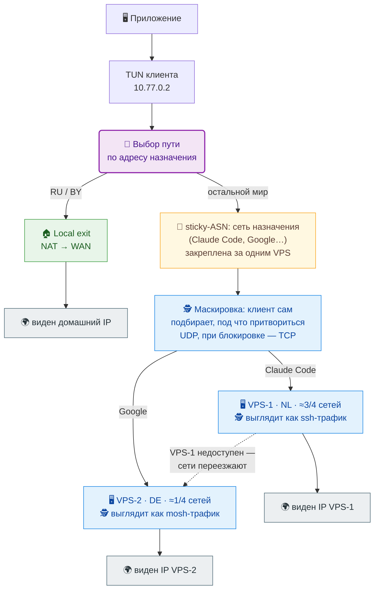

# SVPN

SVPN — это VPN-клиент и VPN-сервер в одном исполняемом файле. Клиент сам
запускает сервер на VPS по SSH на время сессии: на VPS не нужен демон,
systemd-сервис или отдельный конфиг.

## Как это работает



Клиент выбирает путь до шифрования. Адреса из `local-exits` (например, RU и BY)
идут через локальный выход — сайт видит ваш домашний IP. Остальные адреса
шифруются и уходят на VPS — сайт видит IP сервера. В режиме нескольких VPS
`sticky-asn` закрепляет каждый ASN назначения за одним сервером, чтобы сервис
видел стабильный внешний IP. Трафик маскируется: клиент сам подбирает, под что
притвориться на канале, и переходит на TCP, если UDP заблокирован.

## Быстрый старт

Понадобится Linux-клиент и один Linux-VPS с root SSH. На клиенте нужны TUN,
`iproute2` и `nftables`. На VPS откройте SSH, TCP `41020` и UDP `60000–60009`.

### 1. Установите SVPN на клиент

```bash
VERSION=0.9.6
curl -fLO "https://github.com/vadv/svpn/releases/download/v${VERSION}/svpn-${VERSION}-linux-x86_64-gnu.tar.gz"
tar -xzf "svpn-${VERSION}-linux-x86_64-gnu.tar.gz"
sudo install -m 755 svpn /usr/local/bin/svpn
svpn --version
```

Для aarch64 возьмите архив `linux-aarch64-gnu`. В архиве, кроме бинарника, лежат
`scripts/server-up` и `scripts/server-down` — hooks для сервера.

### 2. Проверьте SSH до VPS

```bash
ssh -i /полный/путь/к/ключу root@203.0.113.10
```

Если ключ защищён passphrase, загрузите его в `ssh-agent` заранее. Вместо root
можно использовать обычного пользователя с безпарольным `sudo -n`.

### 3. Создайте конфиг

```bash
sudo install -d -m 700 /etc/svpn
sudoedit /etc/svpn/vpn.toml
```

```toml
# Адрес вашего VPS и SSH-ключ.
server = "203.0.113.10"
ssh-user = "root"
ssh-identity = "/полный/путь/к/ключу"
tcp-port = 41020   # TCP-fallback, если UDP заблокирован

# Хуки на VPS: их установит svpn setup. Настраивают NAT и выход в Интернет.
server-up = "/usr/local/lib/svpn/server-up"
server-down = "/usr/local/lib/svpn/server-down"

# Маршруты на клиенте: весь IPv4 идёт в туннель, дорога до VPS — напрямую.
up-command = "wan=$(ip -4 route show default | awk 'NR==1{print $5}'); gw=$(ip -4 route show default | awk 'NR==1{print $3}'); ip route replace 203.0.113.10/32 via \"$gw\" dev \"$wan\"; ip route replace 0.0.0.0/1 dev \"$SVPN_TUN_NAME\"; ip route replace 128.0.0.0/1 dev \"$SVPN_TUN_NAME\""
down-command = "ip route del 203.0.113.10/32 2>/dev/null || true; ip route del 0.0.0.0/1 2>/dev/null || true; ip route del 128.0.0.0/1 2>/dev/null || true"
```

Замените адрес VPS и путь к ключу. Тот же адрес уже стоит в `up-command` и
`down-command` — если меняете его, поменяйте и там.

### 4. Подготовьте VPS

```bash
sudo svpn setup --config /etc/svpn/vpn.toml
```

Команда скачает релиз SVPN прямо на VPS, установит бинарник и hooks и проверит
установку. Конфиг она не меняет. Поддерживаются Debian 12 и Rocky 10 на x86_64
и aarch64.

### 5. Запустите

```bash
sudo -E svpn --config /etc/svpn/vpn.toml
```

Остановить — `Ctrl-C`. Для автозапуска через systemd см. [ADVANCED.md](ADVANCED.md).

### 6. Проверьте

```bash
curl -4 https://ifconfig.me   # должен показать IP вашего VPS
ping -c1 1.1.1.1
```

Если `ifconfig.me` показывает IP VPS, трафик идёт через туннель.

## Что дальше

Всё, что сложнее одного сервера, описано в [ADVANCED.md](ADVANCED.md):

- несколько VPS и распределение по весам;
- выбор по странам и `local-exit` для RU/BY;
- `sticky-asn` — стабильный внешний IP на ASN;
- базы Country и ASN, их обновление;
- hooks и переменные окружения;
- транспорт: mimic, TCP fallback, диапазон UDP-портов;
- systemd и проверка состояния;
- детали `svpn setup`: окружения, fallback, downgrade, статусы.

## Сборка

```bash
cargo build --release --target x86_64-unknown-linux-gnu
cargo test --workspace
```

Проверки перед pull request:

```bash
cargo fmt --all -- --check
cargo clippy --workspace --all-targets -- -D warnings
uvx ruff@0.14.3 check
uvx ruff@0.14.3 format --check
python3 e2e/test_artifacts.py
python3 e2e/test_groups.py
python3 e2e/test_package.py
```

## Дополнительно

- [ADVANCED.md](ADVANCED.md) — расширенные настройки.
- [CHANGELOG](CHANGELOG.md) — история версий.
- [English README](README.en.md).
- `svpn --help` — справка по командам.
