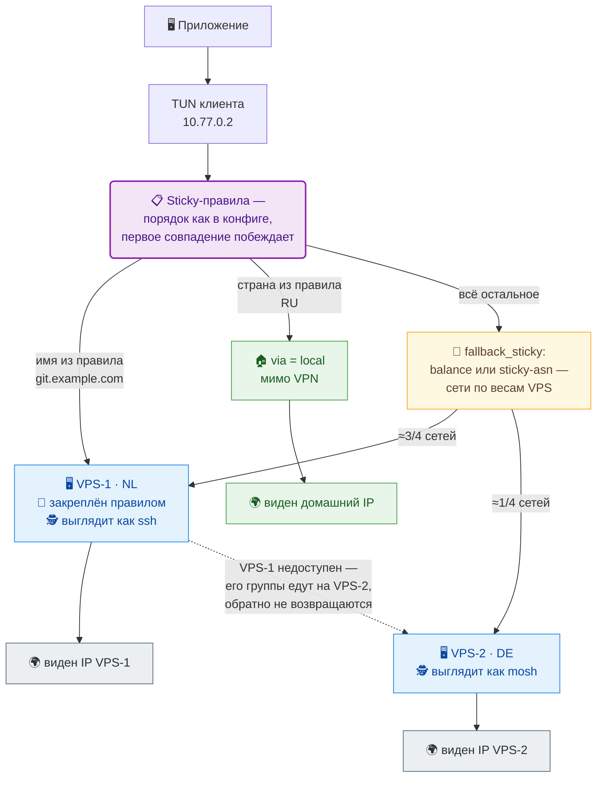

# SVPN

SVPN — это VPN-клиент и VPN-сервер в одном исполняемом файле. Клиент сам
запускает сервер на VPS по SSH на время сессии: на VPS не нужен демон,
systemd-сервис или отдельный конфиг.

## Как это работает



Три ветки схемы — это буквально конфиг: `sticky`-правила проверяются
сверху вниз, первое совпадение решает, куда идёт адрес. Замените домены,
страны и адреса на свои:

```hcl
sticky "work" {
  names = ["git.example.com", "ci.example.com"]
  via   = ["nl"]        # закреплено за одним VPS
  every = "5m"          # имена переразрешаются сами
}

sticky "ru" {
  countries = ["RU"]
  via       = local     # мимо VPN: сайт видит ваш домашний IP
}

# третья ветка схемы — то, что не поймали правила:
fallback_sticky {
  strategy = "sticky-asn"   # или "balance": сети по весам VPS,
}                           # sticky-asn держит каждую за одним сервером
```

Отказ VPS переносит его группы на следующий из `via` и не возвращает их
обратно при оживании — внешний IP не прыгает. `sticky-asn` закрепляет
каждую сеть назначения за одним VPS, чтобы сервис видел стабильный IP.
Трафик маскируется: клиент сам подбирает, под что притвориться на канале,
и переходит на TCP, если UDP заблокирован.

## Быстрый старт

Понадобится Linux-клиент и один Linux-VPS с root SSH. На клиенте нужны TUN,
`iproute2` и `nftables`. На VPS откройте SSH, TCP `41020` и UDP `60000–60009`.

### 1. Установите SVPN на клиент

```bash
VERSION=1.1.0
curl -fLO "https://github.com/vadv/svpn/releases/download/v${VERSION}/svpn-${VERSION}-linux-x86_64-gnu.tar.gz"
tar -xzf "svpn-${VERSION}-linux-x86_64-gnu.tar.gz"
sudo install -m 755 svpn /usr/local/bin/svpn
svpn --version
```

Для aarch64 возьмите архив `linux-aarch64-gnu`.

### 2. Проверьте SSH до VPS

```bash
ssh -i /полный/путь/к/ключу root@203.0.113.10
```

Если ключ защищён passphrase, загрузите его в `ssh-agent` заранее. Вместо root
можно использовать обычного пользователя с безпарольным `sudo -n`.

### 3. Подготовьте VPS

```bash
sudo svpn setup --server 203.0.113.10 --ssh-user root --ssh-identity /полный/путь/к/ключу
```

Команда скачает релиз SVPN прямо на VPS, установит бинарник и проверит
установку. Поддерживаются Debian/Ubuntu (apt) и Rocky/CentOS Stream (dnf) на
x86_64 и aarch64.

В auto выполняются встроенные `scripts/client-up`, `scripts/client-down`,
`scripts/server-up` и `scripts/server-down` из текущего бинарника. Точный
текст этих скриптов можно посмотреть до запуска:

```bash
svpn example client-up
svpn example client-down
svpn example server-up
svpn example server-down
```

Если нужно другое поведение, сохраните вывод, отредактируйте файл и укажите
путь к нему в конфиге — см. [ADVANCED.md](ADVANCED.md).

### 4. Запустите

```bash
sudo -E svpn --server 203.0.113.10 --ssh-user root --ssh-identity /полный/путь/к/ключу
```

Остановить — `Ctrl-C`. Для автозапуска через systemd см. [ADVANCED.md](ADVANCED.md).

### 5. Проверьте

```bash
curl -4 https://ifconfig.me   # должен показать IP вашего VPS
ping -c1 1.1.1.1
```

Если `ifconfig.me` показывает IP VPS, трафик идёт через туннель.

### Несколько VPS — не сложнее одного

Один блок `server` на каждый сервер, общие SSH-настройки сверху. Конфиг — HCL:

```hcl
# vpn.hcl
ssh {
  user     = "root"
  identity = "/полный/путь/к/ключу"
}

server "nl" {
  address = "203.0.113.10"
}

server "de" {
  address = "198.51.100.20"
}
```

```bash
sudo svpn setup --config vpn.hcl      # подготовить оба VPS
sudo -E svpn multi --config vpn.hcl   # запустить
```

`sticky`-правила с этими label'ами (`"nl"`, `"de"`) дописываются в тот же
конфиг — пример из схемы выше уже готов к вставке. Не пойманный блоками
трафик распределяется между серверами по весам (по умолчанию поровну);
отказ одного VPS переезжает на остальные. Подробности — в
[ADVANCED.md](ADVANCED.md).

## Базы Country и ASN — только для sticky-режимов

Для обычного VPN базы не нужны. Они нужны, чтобы закреплять выход по стране
или по ASN (sticky-блоки в ADVANCED). SVPN скачает и будет обновлять их сам —
добавьте в конфиг готовые job-шаблоны и перезапустите:

```bash
svpn example job-geo-update     # готовый job-блок: скопируйте вывод в vpn.hcl
svpn example job-country-update
```

Старт не ждёт базу: если её ещё нет, VPN поднимется в degraded-режиме
(fallback `balance`), job докачает файл в фоне и sticky-режим включится
вживую, без перезапуска. Ручная проверка: `svpn job run geo-update --config
vpn.hcl` (код выхода — коду job'а).

Один раз руками (если job'ы не нужны):

```bash
sudo install -d -m 700 /etc/svpn
YEAR_MONTH=$(date -u +%Y-%m)

curl -fL "https://download.db-ip.com/free/dbip-country-lite-${YEAR_MONTH}.csv.gz" -o /tmp/country.csv.gz
gzip -dc /tmp/country.csv.gz | sudo tee /etc/svpn/country.csv >/dev/null

curl -fL "https://download.db-ip.com/free/dbip-asn-lite-${YEAR_MONTH}.csv.gz" -o /tmp/asn.csv.gz
gzip -dc /tmp/asn.csv.gz | sudo tee /etc/svpn/asn.csv >/dev/null
sudo chmod 600 /etc/svpn/country.csv /etc/svpn/asn.csv
```

Country DB отвечает на вопрос «какая страна у адреса», ASN DB — «какая сеть».
Подключение режимов — в ADVANCED.

## Что дальше

Всё, что сложнее пары серверов из quick start, описано в [ADVANCED.md](ADVANCED.md):

- `sticky`-блоки: закрепление выхода по DNS-именам, IP, ASN и странам;
- `via = local` — пускать избранные адреса мимо VPN;
- `fallback_sticky` — как пул обслуживает остальной трафик;
- базы Country и ASN и их фоновое автообновление (`job`-блоки);
- hooks и переменные окружения;
- транспорт: mimic, TCP fallback, диапазон UDP-портов;
- systemd и проверка состояния;
- детали `svpn setup`: окружения, fallback, downgrade, статусы.

## Сборка

```bash
cargo build --release --target x86_64-unknown-linux-gnu
cargo test --workspace
```

Проверки перед pull request:

```bash
cargo fmt --all -- --check
cargo clippy --workspace --all-targets -- -D warnings
uvx ruff@0.14.3 check
uvx ruff@0.14.3 format --check
python3 e2e/test_artifacts.py
python3 e2e/test_groups.py
python3 e2e/test_package.py
```

## Дополнительно

- [ADVANCED.md](ADVANCED.md) — расширенные настройки.
- [CHANGELOG](CHANGELOG.md) — история версий.
- [English README](README.en.md).
- `svpn --help` — справка по командам.
