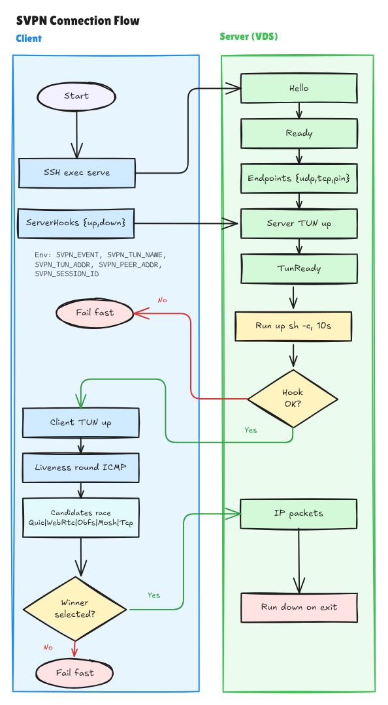

# Server hooks from client TOML



## Goal

Client-side TOML defines `server_up`/`server_down` shell commands that run on the server.
Nothing is stored on the server. Maximum flexibility: administrator writes any shell,
no built-in NAT/masquerade recipes.

## Key facts

- Server mode is `serve` subcommand, CLI-only, no `--config`.
- Client builds server command line (`src/cmdline.rs:27`).
- Control channel: JSONL over stdin/stdout (`src/control.rs`).
- Client hooks already exist (`src/hooks.rs`) — reuse engine.

## Configuration

Client TOML root (default for all servers):

```toml
server_up = "..."
server_down = "..."
```

Per-server override in `[[servers]]`:

```toml
[[servers]]
host = "72.56.22.122"
server_up = "..."    # overrides root for this server
server_down = "..."  # overrides root for this server
```

Both optional. If absent everywhere, no hooks. Per-server values take precedence
over root values.

## Protocol

After server `TunReady`, before client `TunReady`:

- Client → server: `{"type": "server_hooks", "up": "...", "down": "..."}`
- Server executes `up` via `sh -c`, timeout 10s (same as client hooks, `src/hooks.rs:23`).
- Server → client: `{"type": "hook_result", "ok": true, "stdout": "...", "stderr": "..."}`
  - `stdout`/`stderr` truncated to 4 KiB.
- If `ok: false`, client does not send `TunReady` and fails fast.

Server remembers `down` and runs it when `session::run` returns (EOF, shutdown).

## Environment variables

- `SVPN_EVENT` = `up` / `down`
- `SVPN_TUN_NAME` = server TUN name
- `SVPN_TUN_ADDR` = server tunnel address
- `SVPN_PEER_ADDR` = client tunnel address
- `SVPN_SESSION_ID` = PID of serve process

## Flexibility

No built-in NAT, masquerade, or firewall logic. Administrator writes arbitrary shell.
Examples in docs only.

## Errors

- `up` fail/timeout → server not ready, client fails fast.
- `down` fail → warn in server stderr, session closed.
- Old server without `server_hooks` → parse error → client fails fast with clear message.

## Multi-server

Root `server_up`/`server_down` apply to all servers. `[[servers]]` entries override
them per server. Use per-server override when egress or requirements differ; otherwise
write generic shell (`ip route show default | awk '{print $5}'`) once in root.

## Implementation plan

1. `src/config.rs`: `server_up`/`server_down` in root config and per-server override in
   `[[servers]]` (serde, validation, precedence, tests).
2. `src/control.rs`: `ServerHooks` and `HookResult` messages (serde, tests).
3. `src/hooks.rs`: add `SVPN_SESSION_ID`, capture stdout/stderr for `hook_result` (tests).
4. `src/lib.rs` `serve()`: after `TunReady` sent, read `ServerHooks`, run `up`, send
   `HookResult`, remember `down`, run on session end.
5. `src/hub.rs` or client bootstrap: resolve effective `server_up`/`server_down` for the
   current server (per-server override or root), send `ServerHooks`, wait for
   `HookResult`, fail fast on error, then send client `TunReady`.
6. Tests: unit (config, protocol, hooks), e2e (up called, down called, fail fast,
   per-server override wins).
7. Docs: update README/AGENTS.md.

## Compatibility

- New client + old server: client fails fast on unknown message.
- Old client + new server: no hooks, works as before.

## Deployment order

1. Deploy new server binary to all servers in the pool first.
2. Then deploy new client (router) with `server_up`/`server_down` in TOML.

This ensures servers understand `server_hooks` before any client sends it.
